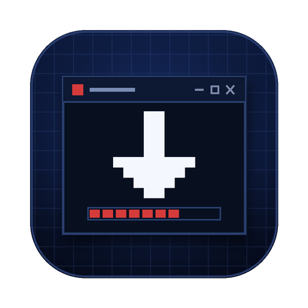
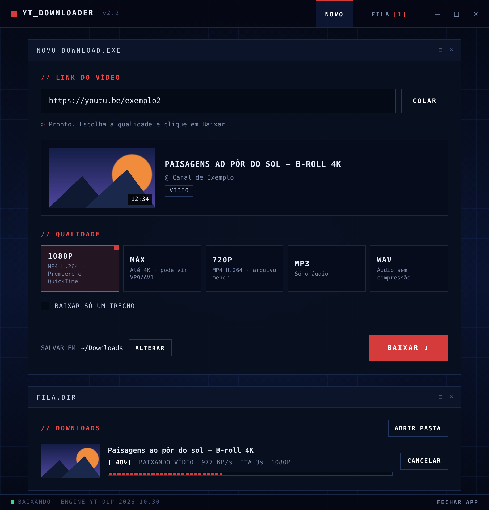

<p align="center">
  
</p>

<h1 align="center">YT Downloader</h1>

<p align="center">
  Baixador de vídeos do YouTube para <b>Mac e Windows</b>, com interface simples e visual de software retrô.<br>
  Cole o link, escolha a qualidade, baixe.
</p>

<p align="center">
  <a href="https://github.com/viny-editor/YT-Dowloader/releases/latest"><b>⬇ Baixar a última versão</b></a>
</p>

<p align="center">
  
</p>

## O que ele faz

- **Prévia automática** — cole o link e aparecem miniatura, título, canal e duração.
- **Qualidades** — 1080p em H.264 (abre direto no Premiere e no QuickTime), máxima até 4K, 720p, MP3 e WAV.
- **Codec: H.264 ou Original** — com **H.264** (padrão), se o vídeo vier em VP9 ou AV1 (comum acima de 1080p) o app converte para H.264 + AAC depois de baixar, usando o chip de vídeo do Mac quando disponível. Com **Original**, salva como vier do YouTube, sem conversão.
- **Baixar só um trecho** — informe início e fim (ex.: `1:20` até `2:45`). Ótimo para B-roll.
- **Playlists inteiras** — numeradas, numa subpasta.
- **Vários ao mesmo tempo** — cole o link, aperte **Enter** e cole o próximo. Até 3 baixam juntos; o resto espera na fila.
- **Pasta por download** — ligue *Perguntar a pasta a cada download* para escolher o destino de cada vídeo, ou deixe desligado para tudo ir para a pasta padrão.
- **Fila de downloads** — na ordem em que os links foram colados, com progresso, velocidade e tempo restante; cancele a qualquer momento.
- **Página Baixados** — todos os vídeos já baixados, numerados na ordem em que você colou os links. Renomeie o arquivo direto na lista, abra, mostre no Finder/Explorer ou busque pelo nome. A lista fica salva entre uma abertura e outra, e o botão **Limpar histórico** esvazia a lista sem apagar nenhum arquivo do computador.
- **Janela própria** no Mac e no Windows — não depende do navegador.
- **Se atualiza sozinho** — o motor de download (yt-dlp) é atualizado uma vez por dia, então o app continua funcionando quando o YouTube muda algo.

## Instalação

Na página de [Releases](https://github.com/viny-editor/YT-Dowloader/releases/latest), baixe o arquivo do seu sistema:

| Sistema | Arquivo |
|---|---|
| macOS 11 ou mais novo (Intel ou Apple Silicon) | `YT-Downloader-Mac.zip` |
| Windows 10 ou 11 | `YT-Downloader-Windows.zip` |

### Mac

1. Descompacte o `YT-Downloader-Mac.zip`.
2. Arraste **YT Downloader.app** para a pasta **Aplicativos**.
3. Abra o app. Como ele não é assinado pela Apple, o macOS vai bloquear na primeira vez:
   **Ajustes do Sistema → Privacidade e Segurança →** role até o fim → **Abrir Mesmo Assim**.
4. A primeira abertura leva de 1 a 2 minutos: o app baixa o que precisa só para ele. Uma notificação avisa quando estiver pronto.

> Se aparecer **"o app está danificado"**, abra o Terminal e rode:
> ```
> xattr -dr com.apple.quarantine "/Applications/YT Downloader.app"
> ```

### Windows

1. Descompacte o `YT-Downloader-Windows.zip` e abra **YT Downloader.exe**, que fica dentro da pasta.
2. Se aparecer "O Windows protegeu o computador" (SmartScreen), clique em **Mais informações → Executar assim mesmo**.
3. O app **se instala sozinho**, só para o seu usuário e sem pedir senha de administrador, em `%LOCALAPPDATA%\Programs\YT Downloader`. Ele cria atalhos na **Área de Trabalho** e no **Menu Iniciar**.
4. Na primeira vez, uma janela de preparação baixa o que o app precisa (1 a 2 minutos).
5. Depois disso, **pode apagar a pasta e o .zip baixados**. Para atualizar, abra uma vez o `.exe` de uma versão nova: ele substitui a instalação.

Em ambos os sistemas é preciso internet na primeira abertura.

## Como funciona por dentro

O app não traz nada pesado embutido. Na primeira abertura ele instala, isolado do resto do sistema, em
`~/Library/Application Support/YT Downloader` (Mac) ou `%LOCALAPPDATA%\YT Downloader` (Windows):

| Componente | Para quê |
|---|---|
| [uv](https://github.com/astral-sh/uv) + Python 3.12 | Roda o app |
| [yt-dlp](https://github.com/yt-dlp/yt-dlp) | Faz os downloads |
| ffmpeg (via [imageio-ffmpeg](https://github.com/imageio/imageio-ffmpeg)) | Junta vídeo + áudio e converte para MP3/WAV |
| [Deno](https://deno.com) | Exigido pelo yt-dlp para o YouTube |
| [pywebview](https://pywebview.flowrl.com) | A janela nativa |

A interface é uma página HTML servida só para o próprio computador (`127.0.0.1`) e exibida numa janela nativa (WebKit no Mac, Edge WebView2 no Windows). O mesmo `app.py` roda nos dois sistemas.

### Estrutura do repositório

```
app/Contents/                  # app do Mac (e o código compartilhado)
├── Info.plist
├── MacOS/YTDownloader         # inicializador do Mac (instala e abre)
└── Resources/
    ├── app.py                 # servidor local + downloads (Mac e Windows)
    ├── index.html             # interface (Mac e Windows)
    └── AppIcon.icns
windows/
├── launcher.py                # inicializador do Windows → vira "YT Downloader.exe"
├── AppIcon.ico
└── LEIA-ME.txt
scripts/set_version.py         # grava o número da versão em todos os arquivos
.github/workflows/release.yml  # gera os dois .zip a cada Release
```

### Publicar uma nova versão

Crie uma **Release** no GitHub com uma tag no formato `v2.5`. A automação monta o
`YT-Downloader-Mac.zip`, compila o `YT-Downloader-Windows.zip` num Windows e anexa os dois
à Release sozinha (leva uns 3 minutos; acompanhe na aba **Actions**).

## Problemas?

- **Desinstalar (Mac):** apague o app e a pasta `~/Library/Application Support/YT Downloader`.
- **Desinstalar (Windows):** apague as pastas `%LOCALAPPDATA%\Programs\YT Downloader` e `%LOCALAPPDATA%\YT Downloader` e os atalhos da Área de Trabalho e do Menu Iniciar.
- **Algo deu errado:** abra uma [issue](https://github.com/viny-editor/YT-Dowloader/issues) com as últimas linhas do registro (`log.txt`):
  - Mac: `tail -40 ~/Library/"Application Support"/"YT Downloader"/log.txt`
  - Windows: abra `%LOCALAPPDATA%\YT Downloader\log.txt` (cole o caminho no Explorador de Arquivos)

## Uso responsável

Use o YT Downloader apenas para baixar conteúdo que você tem o direito de usar: seus próprios vídeos,
material com licença livre ou com autorização do autor. Respeite os direitos autorais e os
Termos de Serviço do YouTube.

## Licença

[MIT](LICENSE) para o código deste repositório. Os componentes listados acima têm suas próprias licenças.
