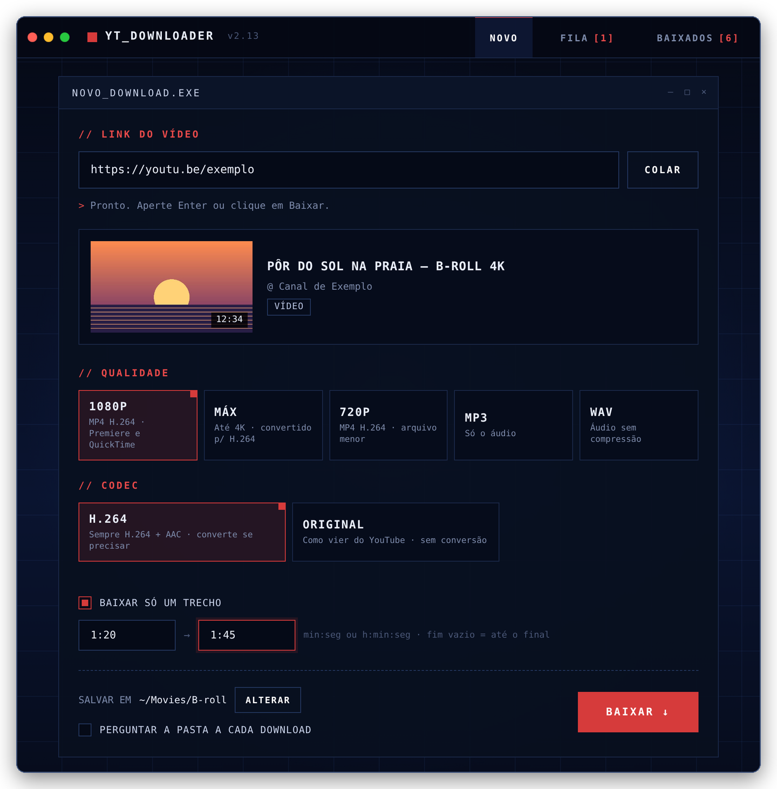
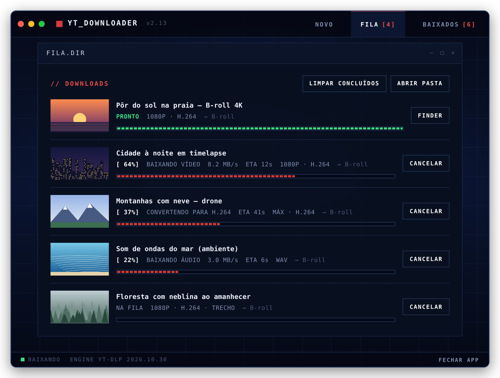
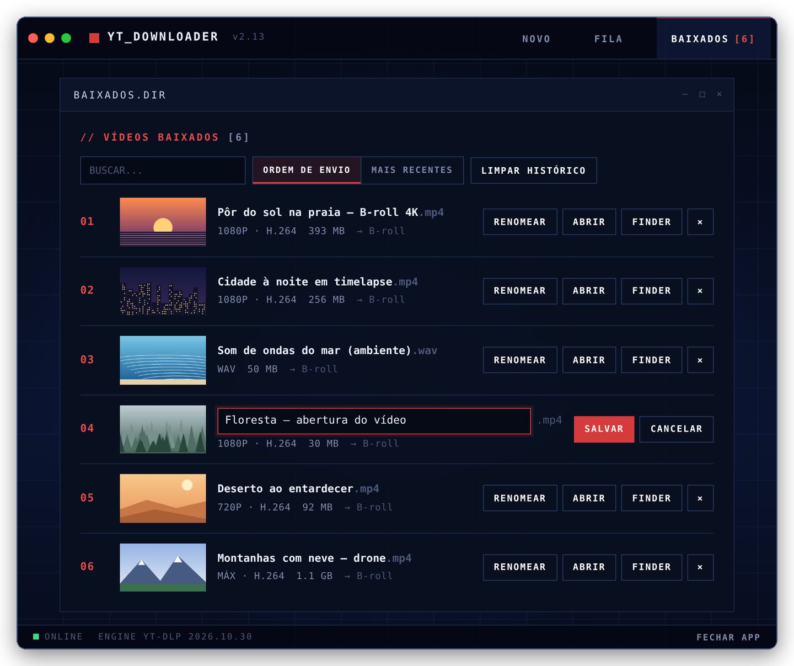
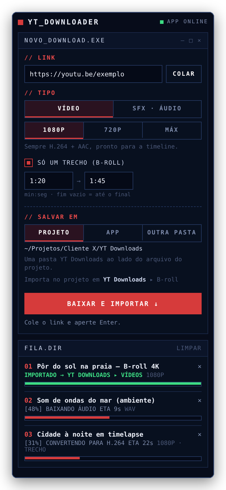
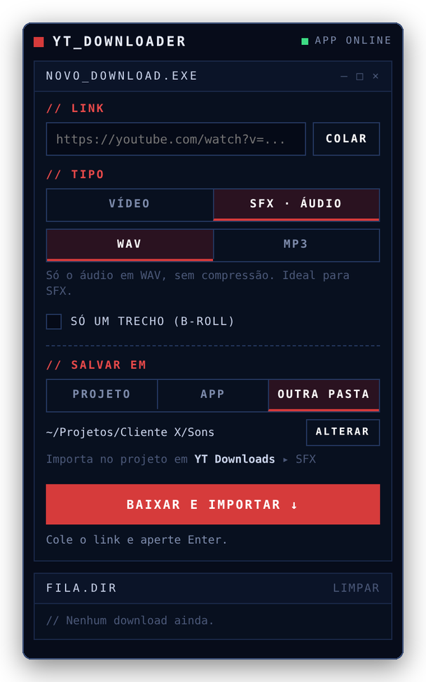
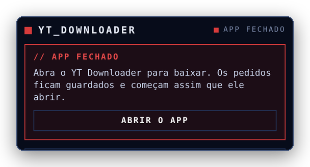

<p align="center">
  
</p>

<h1 align="center">YT Downloader</h1>

<p align="center">
  Baixador de vídeos do YouTube para <b>Mac e Windows</b>, com extensão para o <b>Premiere Pro</b> e visual de software retrô.<br>
  Cole o link, escolha a qualidade, baixe.
</p>

<p align="center">
  <a href="https://github.com/viny-editor/YT-Dowloader/releases/latest"><b>⬇ Baixar a última versão</b></a>
</p>

<p align="center">
  
</p>

<p align="center">
  <a href="#instalação">Instalação</a> ·
  <a href="#como-usar-o-app">Como usar o app</a> ·
  <a href="#extensão-para-o-premiere-pro">Extensão do Premiere</a> ·
  <a href="#problemas">Problemas?</a>
</p>

## O que ele faz

- **Prévia automática** — cole o link e aparecem miniatura, título, canal e duração.
- **Qualidades** — 1080p em H.264 (abre direto no Premiere e no QuickTime), máxima até 4K, 720p, MP3 e WAV.
- **Codec: H.264 ou Original** — com **H.264** (padrão), se o vídeo vier em VP9 ou AV1 (comum acima de 1080p) o app converte para H.264 + AAC depois de baixar, usando o chip de vídeo do Mac quando disponível. Com **Original**, salva como vier do YouTube, sem conversão.
- **Baixar só um trecho** — informe início e fim (ex.: `1:20` até `2:45`). Ótimo para B-roll.
- **Playlists inteiras** — numeradas, numa subpasta.
- **Vários ao mesmo tempo** — cole o link, aperte **Enter** e cole o próximo. Até 3 baixam juntos; o resto espera na fila.
- **Pasta por download** — ligue *Perguntar a pasta a cada download* para escolher o destino de cada vídeo, ou deixe desligado para tudo ir para a pasta padrão.
- **Fila de downloads** — na ordem em que os links foram colados, com progresso, velocidade e tempo restante; cancele a qualquer momento.
- **Página Baixados** — todos os vídeos já baixados, numerados na ordem em que você colou os links. Renomeie o arquivo direto na lista, abra, mostre no Finder/Explorer ou busque pelo nome. A lista fica salva entre uma abertura e outra, e o botão **Limpar histórico** esvazia a lista sem apagar nenhum arquivo do computador.
- **Janela própria** no Mac e no Windows — não depende do navegador.
- **Se atualiza sozinho** — o motor de download (yt-dlp) é atualizado uma vez por dia, então o app continua funcionando quando o YouTube muda algo.

## Instalação

Na página de [Releases](https://github.com/viny-editor/YT-Dowloader/releases/latest), baixe o arquivo do seu sistema:

| Sistema | Arquivo |
|---|---|
| macOS 11 ou mais novo (Intel ou Apple Silicon) | `YT-Downloader-Mac.zip` |
| Windows 10 ou 11 | `YT-Downloader-Windows.zip` |
| Extensão do Premiere Pro (Mac e Windows) | `YT-Downloader-Premiere.ccx` |

### Mac

1. Descompacte o `YT-Downloader-Mac.zip`.
2. Arraste **YT Downloader.app** para a pasta **Aplicativos**.
3. Abra o app. Como ele não é assinado pela Apple, o macOS vai bloquear na primeira vez:
   **Ajustes do Sistema → Privacidade e Segurança →** role até o fim → **Abrir Mesmo Assim**.
4. A primeira abertura leva de 1 a 2 minutos: o app baixa o que precisa só para ele. Uma notificação avisa quando estiver pronto.

> Se aparecer **"o app está danificado"**, abra o Terminal e rode:
> ```
> xattr -dr com.apple.quarantine "/Applications/YT Downloader.app"
> ```

### Windows

1. Descompacte o `YT-Downloader-Windows.zip` e abra **YT Downloader.exe**, que fica dentro da pasta.
2. Se aparecer "O Windows protegeu o computador" (SmartScreen), clique em **Mais informações → Executar assim mesmo**.
3. O app **se instala sozinho**, só para o seu usuário e sem pedir senha de administrador, em `%LOCALAPPDATA%\Programs\YT Downloader`. Ele cria atalhos na **Área de Trabalho** e no **Menu Iniciar**.
4. Na primeira vez, uma janela de preparação baixa o que o app precisa (1 a 2 minutos).
5. Depois disso, **pode apagar a pasta e o .zip baixados**. Para atualizar, abra uma vez o `.exe` de uma versão nova: ele substitui a instalação.

Em ambos os sistemas é preciso internet na primeira abertura.

## Como usar o app

### 1. Baixar um vídeo

<p align="center"></p>

1. Copie o link do vídeo no YouTube e clique em **COLAR** (ou use ⌘V / Ctrl+V no campo). A prévia aparece sozinha.
2. Escolha a **qualidade**:
   - **1080P** ou **720P**: MP4 em H.264, abre direto no Premiere e no QuickTime.
   - **MÁX**: até 4K. O YouTube não tem H.264 acima de 1080p, então o app converte depois de baixar (demora mais).
   - **MP3** ou **WAV**: só o áudio.
3. Escolha o **codec**: **H.264** (recomendado, sempre compatível) ou **ORIGINAL** (como vier do YouTube, sem conversão).
4. Para pegar só um pedaço, marque **BAIXAR SÓ UM TRECHO** e preencha início e fim, como `1:20` → `1:45`. Deixe o fim vazio para ir até o final.
5. Aperte **Enter** ou clique em **BAIXAR**.

**Onde salva:** na pasta de **SALVAR EM** (troque em **ALTERAR**). Marque **PERGUNTAR A PASTA A CADA DOWNLOAD** para escolher a pasta de cada vídeo.

> **Dica:** não precisa esperar. Cole o link, aperte **Enter**, cole o próximo e aperte **Enter** de novo.

### 2. Acompanhar a fila

<p align="center"></p>

A aba **FILA** mostra os downloads na ordem em que você colou os links. Até 3 baixam ao mesmo tempo, e o resto espera a vez.
Cada um mostra o progresso, a velocidade e o tempo restante, inclusive durante a conversão para H.264.
**CANCELAR** interrompe; **FINDER** (ou **EXPLORER** no Windows) mostra o arquivo pronto.

### 3. Encontrar e renomear o que você baixou

<p align="center"></p>

A aba **BAIXADOS** guarda todos os vídeos já baixados, numerados na ordem em que você colou os links.

- **RENOMEAR** (ou clique no nome): digite o novo nome e aperte **Enter** para salvar ou **Esc** para cancelar. A extensão (`.mp4`, `.wav`) é mantida.
- **ABRIR** abre o arquivo; **FINDER/EXPLORER** mostra na pasta; **×** tira da lista sem apagar o arquivo.
- **BUSCAR** filtra pelo nome; **ORDEM DE ENVIO / MAIS RECENTES** muda a ordem.
- **LIMPAR HISTÓRICO** esvazia a lista. Os arquivos no computador **não** são apagados.

## Extensão para o Premiere Pro

Baixe vídeos, SFX e trechos de B-roll **sem sair do Premiere**. O arquivo entra sozinho no projeto, numa pasta
**YT Downloads**, pronto para arrastar para a timeline.

**Requisitos:** Premiere Pro **25.6 ou mais novo** e o app YT Downloader instalado e **aberto**, porque é ele quem faz os downloads.

### Instalar

1. Baixe o `YT-Downloader-Premiere.ccx` na página de [Releases](https://github.com/viny-editor/YT-Dowloader/releases/latest).
2. Dê dois cliques nele. O Creative Cloud abre e avisa que a extensão não vem da loja da Adobe: clique em **Instalar**.
3. Abra (ou reinicie) o Premiere e vá em **Janela → UXP Plugins → YT Downloader** (em inglês: *Window → UXP Plugins*).
4. Arraste o painel para encaixá-lo onde preferir, por exemplo ao lado do painel **Projeto**.

Para atualizar, instale o `.ccx` da versão nova do mesmo jeito: ele substitui o anterior.

### Usar

<table>
  <tr>
    <td align="center" valign="top" width="50%">
      <br>
      <sub>Vídeo com trecho para B-roll, e a fila importando no projeto</sub>
    </td>
    <td align="center" valign="top" width="50%">
      <br>
      <sub>Modo SFX (só áudio) salvando em outra pasta</sub>
    </td>
  </tr>
</table>

1. **Cole o link** no campo (**COLAR** ou ⌘V / Ctrl+V).
2. **Escolha o tipo**:
   - **VÍDEO**: 1080P, 720P ou MÁX, sempre em H.264 + AAC.
   - **SFX · ÁUDIO**: só o som, em **WAV** (sem compressão, o ideal para SFX) ou **MP3**.
3. **B-roll:** marque **SÓ UM TRECHO (B-ROLL)** e preencha início e fim.
4. **Escolha onde salvar** em **SALVAR EM**:
   - **PROJETO**: numa pasta `YT Downloads` ao lado do arquivo do projeto (o projeto precisa estar salvo).
   - **APP**: na mesma pasta configurada no app.
   - **OUTRA PASTA**: escolha qualquer pasta. Use **ALTERAR** para trocar depois.
5. Aperte **Enter** ou **BAIXAR E IMPORTAR**. Já pode colar o próximo link.

Quando o download termina, o painel importa o arquivo e a fila mostra **IMPORTADO**. No painel **Projeto** do Premiere, as pastas ficam assim:

```
YT Downloads
├── Vídeos     ← vídeos inteiros
├── SFX        ← só áudio
└── B-roll     ← trechos
```

Daí é só arrastar para a timeline. O **×** de cada item cancela o download ou tira da lista; **LIMPAR** remove da fila os que já terminaram.

### Se o app estiver fechado

<p align="center"></p>

O painel mostra **APP FECHADO**. Clique em **ABRIR O APP** (ou abra o YT Downloader normalmente). Os links que você colar
enquanto isso ficam guardados e começam a baixar assim que o app abrir.

> **Por que precisa do app aberto?** O Premiere não deixa extensões usarem `http://` no Mac, então o painel conversa com o
> app por arquivos numa pasta compartilhada (`YT Downloader/premiere`). O app faz o download e o painel importa no projeto.

## Como funciona por dentro

O app não traz nada pesado embutido. Na primeira abertura ele instala, isolado do resto do sistema, em
`~/Library/Application Support/YT Downloader` (Mac) ou `%LOCALAPPDATA%\YT Downloader` (Windows):

| Componente | Para quê |
|---|---|
| [uv](https://github.com/astral-sh/uv) + Python 3.12 | Roda o app |
| [yt-dlp](https://github.com/yt-dlp/yt-dlp) | Faz os downloads |
| ffmpeg (via [imageio-ffmpeg](https://github.com/imageio/imageio-ffmpeg)) | Junta vídeo + áudio e converte para MP3/WAV |
| [Deno](https://deno.com) | Exigido pelo yt-dlp para o YouTube |
| [pywebview](https://pywebview.flowrl.com) | A janela nativa |

A interface é uma página HTML servida só para o próprio computador (`127.0.0.1`) e exibida numa janela nativa (WebKit no Mac, Edge WebView2 no Windows). O mesmo `app.py` roda nos dois sistemas.

### Estrutura do repositório

```
app/Contents/                  # app do Mac (e o código compartilhado)
├── Info.plist
├── MacOS/YTDownloader         # inicializador do Mac (instala e abre)
└── Resources/
    ├── app.py                 # servidor local + downloads (Mac e Windows)
    ├── index.html             # interface (Mac e Windows)
    └── AppIcon.icns
windows/
├── launcher.py                # inicializador do Windows → vira "YT Downloader.exe"
├── AppIcon.ico
└── LEIA-ME.txt
premiere/                      # extensão do Premiere (vira YT-Downloader-Premiere.ccx)
├── manifest.json
├── index.html, styles.css, main.js
└── icons/
scripts/set_version.py         # grava o número da versão em todos os arquivos
.github/workflows/release.yml  # gera os 3 arquivos da Release
```

### Publicar uma nova versão

Crie uma **Release** no GitHub com uma tag no formato `v2.14`. A automação monta o
`YT-Downloader-Mac.zip` e a extensão `YT-Downloader-Premiere.ccx`, compila o `YT-Downloader-Windows.zip`
num Windows e anexa os três à Release sozinha (leva uns 3 minutos; acompanhe na aba **Actions**).

## Problemas?

- **Desinstalar (Mac):** apague o app e a pasta `~/Library/Application Support/YT Downloader`.
- **Desinstalar (Windows):** apague as pastas `%LOCALAPPDATA%\Programs\YT Downloader` e `%LOCALAPPDATA%\YT Downloader` e os atalhos da Área de Trabalho e do Menu Iniciar.
- **Extensão do Premiere não aparece:** confira se o Premiere é 25.6 ou mais novo e se a extensão está em **Creative Cloud → Plugins → Gerenciar plugins**. Reinicie o Premiere depois de instalar.
- **Painel diz APP FECHADO com o app aberto:** feche e abra o app de novo. O painel considera o app aberto quando ele dá sinal de vida a cada 1,5 segundo.
- **Desinstalar a extensão:** **Creative Cloud → Plugins → Gerenciar plugins → ••• → Desinstalar**.
- **Algo deu errado:** abra uma [issue](https://github.com/viny-editor/YT-Dowloader/issues) com as últimas linhas do registro (`log.txt`):
  - Mac: `tail -40 ~/Library/"Application Support"/"YT Downloader"/log.txt`
  - Windows: abra `%LOCALAPPDATA%\YT Downloader\log.txt` (cole o caminho no Explorador de Arquivos)

## Uso responsável

Use o YT Downloader apenas para baixar conteúdo que você tem o direito de usar: seus próprios vídeos,
material com licença livre ou com autorização do autor. Respeite os direitos autorais e os
Termos de Serviço do YouTube.

## Licença

[MIT](LICENSE) para o código deste repositório. Os componentes listados acima têm suas próprias licenças.
